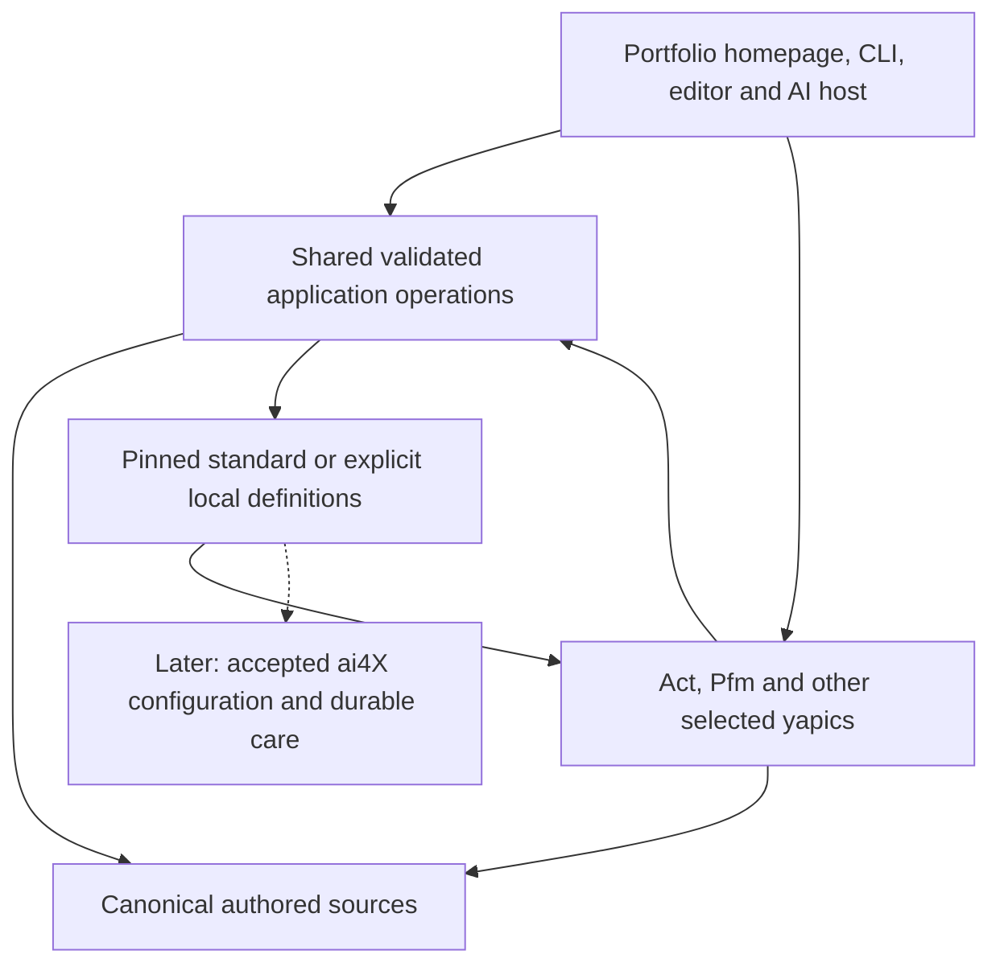

# The next yap architecture

yap should help you manage activities and understand their contributions to your
goals. **Act (Activity)** and **Pfm (Performance)** are the selected standard yapics.
A new portfolio should start with empty personal data and both available through
the same contract as other yapics.

After cloning the application, **make yap** should offer **Create a portfolio**
or **Open an existing portfolio**. It should open the selected portfolio's own
homepage. A text editor, terminal and assisting AI host remain complete working
paths alongside the interface, using the same sources and application operations.

This is the discussion proposal for [issue #3](https://github.com/normenmueller/yap/issues/3).
The [current application boundary](architecture.md) owns delivered Python behavior.
**Python remains the application/domain core until further notice.** The full
creation journey and generic saved yapic definitions remain product goals; they
do not require a language replacement. The current work strengthens the Python
design and checks its concrete defects. The owner accepted PR #14; the superseded
#3/#4 language-replacement plan is closed as not planned. #23 retains Python create/open and identity, #12 durable
definitions/care and #24 further typed domain/module work. These goals remain
unfinished product scope.

<details>
<summary>Architecture, technical choices and open decisions</summary>

## Product direction and open decisions

The selected product direction is:

- Keep one shared activity basis and ship Act/Pfm as standard yapics, using the
  same public definition, operation and presentation contract as other yapics.
- Keep application development separate from each portfolio's sources, private
  configuration, generated output and assistance context.
- Provide an executable guided create/open journey. A written walkthrough alone
  does not deliver it. Local use requires no hosting account or application fork.
- Support agent-assisted work from the start through deterministic operations;
  accepted ai4X curation and activation remain later, separate integration.
- Design initial durable definitions and the complete constellation-context
  boundary now, without requiring an accepted provider binding to use Act/Pfm.
- Keep repository inspection and bounded operations shared across yapics. Shared
  work-observation collection is a candidate core capability; a specific view
  selects and explains those observations.

The hypothesis **yapic as a supported activity / yapic als betreute Aktivität**
remains open at the identity/lifecycle level. One candidate is an activity with a
saved yapic definition and dedicated care association; an alternative is a
separate maintained artifact linked to an activity. Do not reclassify existing
sources or fabricate activity/team identities to satisfy either hypothesis.

A future supported yapic distinguishes activity identity, need/definition,
maintained artifacts, accepted constellation, durable context and bounded
assignments. Persistent care does not require a running agent; assignment status,
artifact readiness and human acceptance remain distinct.

## Application and portfolio ownership

The dependency is **portfolio → explicitly selected application**. Application
code, history, tests, documentation and tracked development context contain only
generic examples and no particular portfolio data, names, locations or workflow
links. Private integration experience must become a minimal synthetic reproduction
before entering public tests or discussions.

| Owner | Content and boundary |
| --- | --- |
| Application | Shared interpretation/operations, executable presenters, standard definitions/catalog and product assets. |
| Portfolio | Manifest/identity, authored pfo sources including activity/area workspace maps, saved pov arrangements, branding, own definitions and assistance context. |
| Private configuration | Explicit application discovery and other local settings; no sibling-directory search. |
| External workspace | Actual project work, reached only through explicit bindings and authorized operations. |

The delivered workspace contract is source-owned YAML `wsp` with named
`wsp/NAME` navigation. The [authoring guide](authoring.md#local-workspaces) owns
its exact rules, publication exclusions and explicit legacy migration. A binding
may enter the instance's source history; its owner decides whether that is
appropriate. The proposed architecture retains this owner rather than restoring
a private override layer. Workspace targets are not portfolio source-discovery
roots, and a declared binding grants no operation authority.

The Python application's resource root belongs to the application; the process
selects its instance explicitly. Keep only a thin selected-version invocation in
a portfolio. Improve semantic boundaries within this application. A browser
interface may use TypeScript, calling the same Python application operations;
it must not maintain synchronized business rules or a second source store.

Application development and portfolio assistance have independent `.ai4x` context
and `.yap` runtime/configuration. Opening a portfolio neither copies the
application team into it nor proves accepted ai4X care. Instance bootstrap context
states purpose, source owners, selected application, bounded effects and a return
point; it is distinct from development instructions.

## Shared operations and presentations



An Activity Board may offer drag-and-drop while another view is read-only. The
requested effect determines whether an interaction changes tracking or moves a
placement. Arranging a view creates no source relationship, priority or KR value.
Versions, tracking, measurements, observations and Todo lifecycle retain their
own rules rather than one generic status/progress field.

Repository operations are shared, but "update" must distinguish fetch, merge and
rebase. Bulk selection, failure behavior and remote effects need explicit scope.
A listed operation or saved definition grants no execution authority. Work
observations need stable identity and provenance; a commit, Todo completion or
quip does not establish achievement or personal causal impact.

Actual quip identification is a concrete architecture use case, owned by
[#8](https://github.com/normenmueller/yap/issues/8). The current scene contains
explicitly illustrative data. The design must establish what qualifies as one
quip, its evidence and activity association, stable identity and recognition on
refresh. Several observed events may concern the same work; the identification
rule remains to be agreed. Collection belongs behind shared operations, while
Pfm selects and explains its evidence. No provider or collection implementation
is selected by this discussion.

## Guided creation and opening

The proposed application-root `make yap` is a thin CLI entry. Prompts and explicit
noninteractive arguments call the same create/open operations as a future UI.
The current Python CLI can open an explicitly selected existing instance; it does
not yet implement this full wizard.

1. Check prerequisites and the selected application revision, with actionable
   diagnostics rather than a custom runtime/package manager.
2. Offer Create / Portfolio erstellen and Open / Portfolio öffnen.
3. Create asks for name/location outside the application; Open asks for an existing
   portfolio. Explicit arguments avoid prompts and fail clearly when intent is missing.
4. Preview identity, location, exact application selection, standard Act/Pfm and
   empty sources, or the recognized existing instance.
5. Open the instance's `<slug>.html` homepage. Act/Pfm are choices there. Empty
   states invent neither activities, goals, measurements nor accepted care.

Create generates durable identity independently of name/path and never overwrites
unknown content. Success requires a complete validated instance. Interrupted
creation must distinguish its own partial result and support bounded recovery
without duplicating identity or cleaning unrelated content.

Open validates identity/schema, exact application pin and source compatibility;
it does not create/migrate an instance, replace saved arrangements, update its pin
or fall back to a moving development head. Refreshing derived output and reconciling
explicit private navigation remain ordinary bounded operations. Git init, hosting,
commit/push and publication are separate actions. Remembering a location, if
provided, is private convenience rather than required shared state.

## Durable definitions and identity

Propose **data-only YAML** plus a static catalog of source, operation and presenter
IDs in the pinned application. Standard Act/Pfm and local definitions use the
same decoder. YAML selects reviewed behavior; it cannot name arbitrary imports,
shell commands or new domain rules. A dynamic plugin framework is not selected.

Illustrative `dev/acc/yapics/act.yaml` (candidate vocabulary, no delivered decoder):

```yaml
schema: 1
key: act
title: Act
need: Manage activities and choose the next useful work.
inputs: [activities]
operations: [inspect-activities, change-tracking]
presentations: [activity-board]
care:
  kind: unbound
```

Pfm uses the same contract for activity/goal inputs and Performance presenters.
Unbound records absence of a care association, not an empty accepted constellation.
Definition identity differs from activity identity; creating a portfolio does not
register artificial Act/Pfm activities in its authored corpus.

One small JSON manifest owns the application pin and selections. The delivered
Python application uses `sources.aspirations` (default `pfo/asp`, accepted in
#15 / PR #16). The candidate retains that vocabulary. Other source selectors,
durable identity and yapic selections remain proposed; only the optional
aspiration selector is delivered. This candidate example contains placeholders
and is not a runnable manifest:

```json
{
  "schema": 1,
  "key": "<generated-stable-instance-id>",
  "name": "My portfolio",
  "slug": "my-portfolio",
  "application": {"version": "<selected-release>", "revision": "<immutable-revision>"},
  "sources": {"activities": "pfo/act", "aspirations": "pfo/asp"},
  "yapics": [{"kind": "standard", "key": "act"}, {"kind": "standard", "key": "pfm"}]
}
```

Rename, move and restore preserve instance identity. A filesystem copy still
represents the same identity; deliberately creating a distinct portfolio generates
a new key. Standard references resolve only inside the pinned release. Local
references use a distinct case with an instance-relative file:

```yaml
yapics:
  - kind: local
    file: yapics/my-review.yaml
```

The definition key comes from its content, independently of filename. Its identity
includes standard/local origin and exact source revision. Reject duplicate or
ambiguous selections; a local file never implicitly shadows a standard key.
Code, catalog and bundled definitions share one immutable application revision.
Default arrangements belong to standard definitions; saved personal arrangements
belong to pov. Resolve references from their declared owner and report unknown,
unavailable or incompatible IDs without inventing a fallback.

## Directory proposal

The current application uses `doc` and `dev/{src,tst,acc}` with its own `.ai4x` and
ignored `.yap/local`. Create directories only for real content; aim for at most
seven semantic child directories per level, nine as the design ceiling.

Current Python source layout:

```text
application/
├── AGENTS.md
├── README.md
├── LICENSE
├── Makefile
├── .ai4x/                    # application-development context
├── .yap/local/               # ignored development output
├── doc/                      # reusable operation, authoring and architecture
└── dev/
    ├── src/yap/              # current Python application modules
    ├── tst/                  # generic regression fixtures and checks
    └── acc/
        ├── templates/        # shared TeX/Lua/workspace templates
        └── assets/           # original product artwork
```

An existing separated portfolio selects that application explicitly. Its current
thin runner and optional authored/private material are distinct from the later
empty-instance initializer:

```text
my-portfolio/
├── AGENTS.md
├── Makefile                  # delegates to the selected application
├── yap.json                  # identity, branding and exact application pin
├── .ai4x/                    # portfolio assistance context
├── .yap/
│   ├── run.py                # thin invocation, no copied application rules
│   ├── cfg/                  # ignored application discovery/local settings
│   └── local/                # ignored generated output
├── acc/                      # instance-owned branding/accompanying material
├── doc/                      # optional existing human-facing instance guides
├── pfo/
│   ├── act/
│   ├── asp/                  # default; legacy okr requires explicit selection
│   └── nts/
└── pov/                      # saved arrangements and explicit local navigation
```

An existing `pfo/okr` remains usable when explicitly selected through
`sources.aspirations`; no automatic move or fallback lookup is delivered.
Instance operation/recovery context belongs to `.ai4x`; an instance `doc/`
directory is optional and does not duplicate reusable application manuals.

The [engineering appendix](architecture-engineering.md) describes semantic values,
shared operations, adapters and presenters as responsibilities within the Python
application. Introduce directories or packages only when a real boundary warrants
them. Standard-definition files under `dev/acc/yapics/` remain proposed content.

A newly created portfolio needs only valid empty sources, its manifest, ignore
rules and a thin assistance entry:

```text
my-portfolio/
├── .gitignore
├── AGENTS.md
├── yap.json
├── .ai4x/
│   ├── BEHAVIOR.md
│   ├── CONTEXT.md
│   ├── STATE.md
│   └── TEAM.md
└── pfo/
    ├── act/act.md
    └── asp/goals.md
```

Add `pfo/nts`, saved `pov/<name>`, own `yapics`, branding `acc` and private
`.yap/cfg`/generated `.yap/local` only when used. Ignore private settings/runtime
before creating them. Do not fabricate per-yapic team directories or accepted
provider references. The concrete full constellation-context location remains an
explicit design decision.

## Constellation context and later ai4X integration

The referenced [curation algebra](https://github.com/normenmueller/ai4X/blob/5d64443ed6db1b0b331e81b458daa4f8adcb59e5/.ai4x/context/curation.md)
defines selected cognitive Capabilities, a Cognitive Agent Team (AI agents only)
and an Operating Model with Collaboration, Work Management and Governance Models.
Preserve all three organizational models, rationale, coverage/gaps and exact
source revisions rather than a vague team-context string.

A proposed referenced `ConstellationDesign` distinguishes need, capabilities,
AI-team composition, the three operating-model parts, rationale and unresolved
gaps. A local design proposal and an actual accepted provider configuration are
distinct cases. Accepted care requires the real configuration reference, acceptance
evidence and durable context; plausible agent names or boolean flags cannot
establish it. Care of a released standard definition does not become care of its
use in an individual portfolio.

The referenced provider revision does not define the complete concrete
serialization/persistence/activation adapter needed here. This is a yap-owned
content proposal, not a provider schema or an instruction to that team. Define
compatible versions and unavailable/partial-outcome behavior before later
integration. No provider command, synthetic accepted team or automatic activation
is part of the initial foundation. Team re-curation cannot silently change the
configuration under a running assignment; outputs retain relevant input/configuration
revisions and proposed/accepted status.

## Technology, compatibility and limits

Python is the selected core. Use precise semantic values, checked construction,
cohesive modules and bounded effects to improve it. The existing codebase is not
fully typed or separated into a completed target architecture; the engineering
appendix identifies the bounded type gate and remaining design debt.

TypeScript remains suitable for richer browser presentation. Shared application
rules stay in Python; no independent browser domain runtime is required by the
current backlog. TypeScript and Haskell were considered as replacement options;
the owner selected neither. A future change needs concrete product evidence and
a new decision. No UI framework or future public API is selected here.

The [engineering appendix](architecture-engineering.md) owns candidate module/type
boundaries, construction and proof limits. Preserve canonical IDs, source fields,
versions, explicit relationships, saved arrangements, publication destinations
and authored content until an accepted migration specifies changes. Keep full
terminal/editor/AI-host use and compare accepted boards, nested lanes, trees,
graphs and PDFs before accepting visual losses. Bilingual interfaces/guidance are
a target; existing authored language and the retained German presentation baseline
remain distinct from delivered localization.

An optional graphical/editor host must not become a second corpus or domain-rule
owner. A corpus-only host must exclude external private workspaces deliberately;
symlink/index exclusions are not a plugin filesystem sandbox. Mobile behavior and
stronger external-editor write protocols remain separate requirements.

## Issue ownership and first delivery

| Owner | Scope |
| --- | --- |
| [#3](https://github.com/normenmueller/yap/issues/3) | Accepted Python decision and quality delivery in PR #14; the superseded language-replacement plan is closed as not planned. |
| [#4](https://github.com/normenmueller/yap/issues/4) | Superseded TypeScript foundation, closed as not planned; its Python product obligations remain in #23/#12. |
| [#23](https://github.com/normenmueller/yap/issues/23) | Python create/open, stable portfolio identity, empty-source construction and safe retry carried forward from #3/#4. |
| [#24](https://github.com/normenmueller/yap/issues/24) | Remaining checked Python domain boundaries and separation of source semantics from presentation. |
| [#12](https://github.com/normenmueller/yap/issues/12) | Durable definitions and future care references. |
| [#5](https://github.com/normenmueller/yap/issues/5) | Ordinary YAML authoring for saved perspectives; paused pending the relevant design. |
| [#7](https://github.com/normenmueller/yap/issues/7), [#8](https://github.com/normenmueller/yap/issues/8) | Repository operations and work observations/provenance. |
| [#10](https://github.com/normenmueller/yap/issues/10), [#11](https://github.com/normenmueller/yap/issues/11) | Separately scoped Todo integration and deferred graphical authoring. |

The owner accepted the bounded Python quality delivery in PR #14. The original
#3/#4 language-replacement plan is closed as not planned. #23 retains create/open
and durable identity, #12 definitions/care and #24 further typed domain/module
work; shared operations and compatibility remain obligations of those deliveries.
Refinement still needs identity/reference rules,
writer/conflict behavior, observable acceptance criteria and empty-instance failure
checks. An initial delivery need not claim full Board/Performance parity or
readiness to adopt existing portfolios. Live curation/activation and a universal
plugin runtime remain separate concerns.

Required boundary evidence includes unknown IDs, wrong pins, existing targets,
interrupted creation, consistent interactive/noninteractive operations and
nonmutation of canonical facts by projections. Compare a meaningful existing
presentation before any adoption decision. No test or review of this document
certifies an unimplemented API or authorizes migration.

</details>
